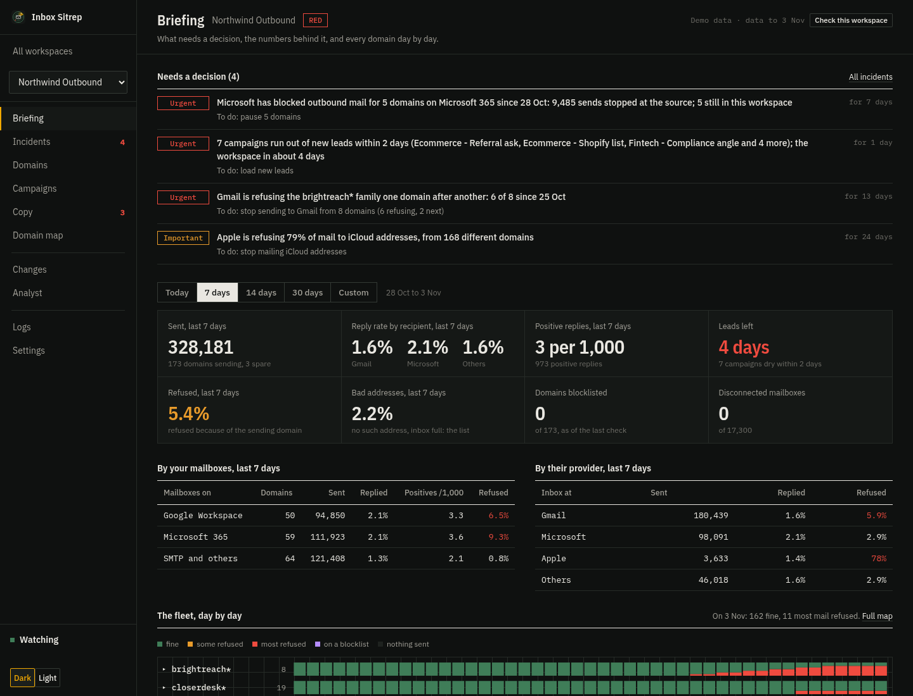
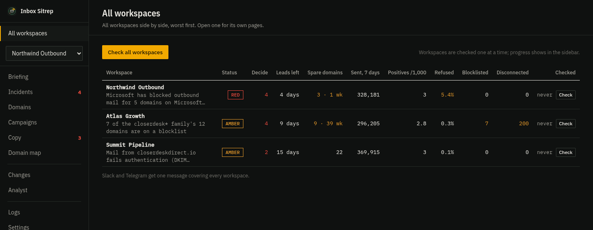
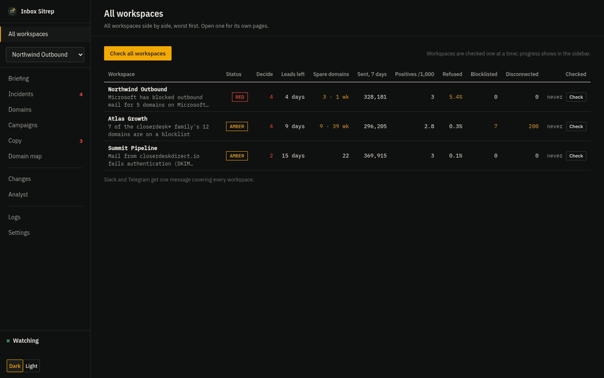
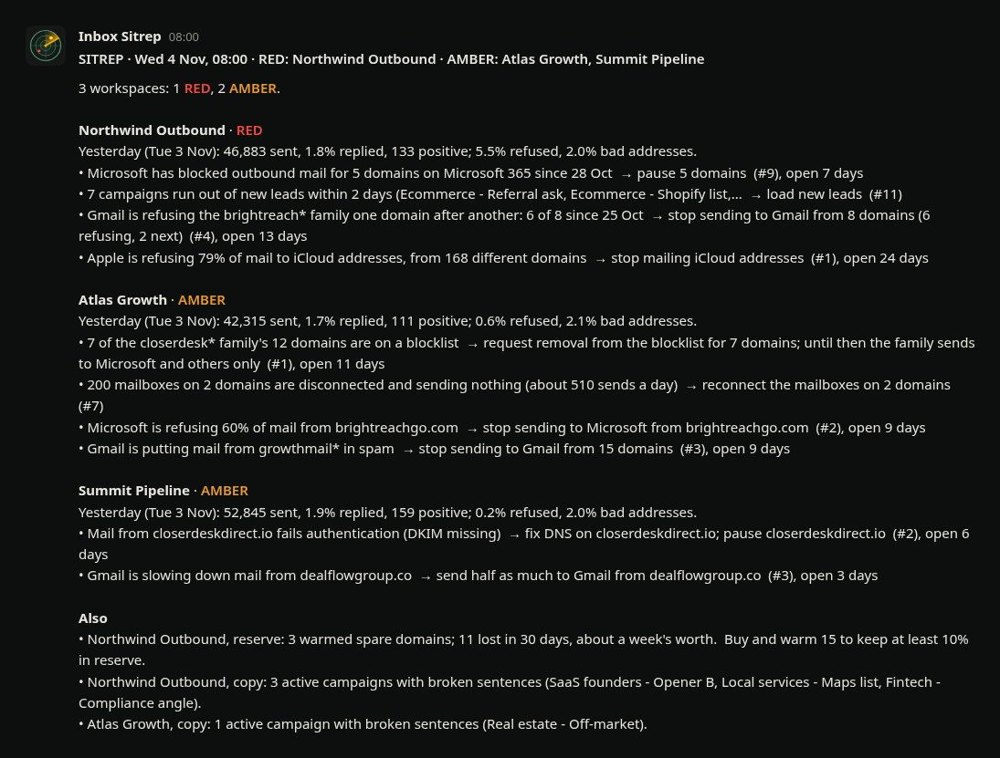

# Inbox Sitrep

**Bottom line:** Inbox Sitrep checks your cold email setup every few hours,
tells you which domains and campaigns have a problem and what to do about it,
and fixes it from the app once you approve: pause domains, cap sending, turn
off warmup or tracking, all with an undo. It works with PlusVibe, Instantly
and EmailBison, runs on your own device, and sends a short report to Slack or
Telegram every morning.

It was built, used and tested against 15+ workspaces, and 200,000+ mailboxes.



## What it does

- **Tells you which domains to stop, fix, delist or keep,** with the numbers
  behind each call.
- **Catches what kills replies:** Gmail blocking your domains one by one,
  Microsoft shutting down a 365 tenant, one receiver blocking dozens of your
  domains, bad lead lists, broken DNS.
- **Shows which campaigns to scale and which to stop,** judged against the
  rest of your workspace.
- **Checks your copy before it sends:** merge fields glued to the next word,
  spintax that never closes, fields your leads don't have, links and tracking
  in the first email, words spam filters score.
- **Tells you how many domains to buy:** how many you lost this month, how many
  warmed spares are ready, and how long they'll last.
- **Warns before your leads run out,** per campaign and per workspace.
- **Fixes it in two clicks:** see exactly what will change, approve it, undo it
  any time.
- **Reports to Slack or Telegram every morning,** and you can ask it questions
  there.

All your workspaces on one page, the ones that need you at the top:





The screenshots use the built-in demo: made-up workspaces and domains, the same
code that runs on real ones.

## Try it

No API key needed. Three demo workspaces, each a mix of Google, Microsoft and
SMTP mailboxes, twelve campaigns apiece, with problems planted in each:

```
pipx install git+https://github.com/miralemalic/inboxsitrep
inboxsitrep demo --dir try
inboxsitrep app --config try/config.json
```

## Install

**Linux**

```
pipx install git+https://github.com/miralemalic/inboxsitrep
inboxsitrep app --install          # adds it to your applications menu
```

**macOS**

```
brew install pipx
pipx install "inboxsitrep[window] @ git+https://github.com/miralemalic/inboxsitrep"
inboxsitrep app --install          # adds Inbox Sitrep to ~/Applications
```

**Windows**

```
py -m pip install --user pipx
py -m pipx install "inboxsitrep[window] @ git+https://github.com/miralemalic/inboxsitrep"
inboxsitrep app --install          # adds Inbox Sitrep to the Start menu
```

Python 3.10 or newer, no other dependencies. Open it, add a workspace in
Settings with its API key, and it reads the last 31 days. After that it only
reads what changed. The [setup guide](docs/SETUP.md) covers each operating
system, Slack and Telegram.

## How it judges a domain

Bounces get sorted by whose problem they are:

| bounce | what happened | where the fix is |
|---|---|---|
| **Refused** | the receiver rejected the mail because of the sender: reputation, a blocklist, failed authentication, a blocked account | the domain |
| **Bad address** | no such mailbox, inbox full, account closed | the lead list |
| **Copy** | a spam filter rejected the message itself | the email copy |

Then each domain gets a verdict from its latest 1,000 sends:

| verdict | when | what to do |
|---|---|---|
| **Burned** | 4% or more refused, and it earns little: positive replies well below the rest of the workspace, or under 1% replies | stop it and replace it |
| **Refused** | 4% or more refused, but it still gets replies | rest it a week, then 10-15 a day to verified leads |
| **Gmail or Microsoft blocks it** | one provider refuses 20% or more while the other takes the mail | stop sending to that provider only |
| **List and domain** | over 5% bounced, 2-4% refused | clean the list and keep an eye on the domain |
| **Bad list** | over 5% bounced, under 2% refused | clean the list, the domain is fine |
| **Fix authentication** | refused over SPF, DKIM or DMARC | fix the DNS record today |
| **Blocklisted** | on Spamhaus or SURBL but still delivering | request removal and keep sending |
| **Underperforming** | delivers, but earns well below the workspace | check Gmail placement and what it sends |
| **Healthy / Strong** | none of the above | keep sending |

A few rules sit behind that table:

- Bounces are judged from 500 sends and replies from 1,000. Below that it says
  "too early" and leaves the domain alone.
- A domain that still gets positive replies is never stopped for being on a
  blocklist. Changing a domain that does well asks you twice.
- About 1% bad addresses is normal on a verified list, so Stop starts at 4%
  refused.
- "Well below" and "twice as good" are statistical tests against your own
  workspace, so one lucky or unlucky week doesn't decide anything.
- The verdict uses each domain's most recent sends whatever date range is on
  screen. A 14-day average can hide a problem that started four days ago.

### Your rules

Set the rules to match your agency's or company's GTM strategy: what counts as
a burned domain, a winning or losing campaign, how many spares to keep. Every
number above can be changed. They live in `rules.ini` next to your
settings (`~/.config/inboxsitrep/rules.ini`, or Settings shows the path),
written with the defaults the first time the app opens, with a comment on
every line. Change a number and save; the next check uses it. The verdict
explanations in the app follow your numbers.

```ini
[domains]
stop_refused_percent = 4      # refused share that stops a domain
protect = acme.com, acmemail* # always ask twice before changing these

[campaigns]
winner_times = 2.0            # times the rest of the workspace's reply rate
loser_times = 0.5
min_reply_percent = 0         # a hard floor, if you want one

[reserve]
cover_days = 30               # spares to cover this many days of losses
min_reserve_percent = 10
```

Mailbox volume and lead warnings are in there too.

## What it looks for

Twenty-five checks. "Seen live" means the problem turned up on real
workspaces; the rest come from the receivers' own documentation and are tested
in the simulator. Every threshold and where it comes from is in
[docs/numbers.md](docs/numbers.md).

**Reputation**

| problem | how it shows | what it recommends | seen live |
|---|---|---|---|
| Dead domain | Gmail refuses 30%+ while Microsoft keeps accepting | Stop Gmail on that domain, keep 10 test sends a day | yes |
| Short episode | The same pattern, gone in 2-4 days at the same volume | Nothing. Wait it out | yes |
| Cascade | Look-alike domains dying one after another | Take the whole family off Gmail before the next one goes | yes |
| Silent spam folder | Gmail replies drop, Microsoft replies hold, nothing bounces | Move Gmail leads to clean domains | yes |
| Gmail gap | Across the workspace, Gmail replies a third of Microsoft's or less | Send Gmail leads only from mailboxes Google still trusts | yes |
| Warmup slide | Google warmup score down 25+ points, under 60 | Stop Gmail on it until the score is back over 70 | |
| Gmail throttle | 421 4.7.28, "unusual rate of unsolicited mail" | Halve Gmail volume for three days. It is the last warning before a block | |
| Microsoft refusal | S3150, 5.7.708, 5.7.511 on 20%+ of Microsoft sends | Stop Microsoft on that domain. Gmail still takes it | yes |
| Complaints | Yahoo's TSS04, "too many complaints" | Pause, check targeting and the opt-out line | rare |

**Blocks and lists**

| problem | how it shows | what it recommends | seen live |
|---|---|---|---|
| Blocklist | Spamhaus or SURBL names the domain, in a bounce or in DNS | Request removal and keep it sending. Pause it only where it gets refused | yes |
| Listed link | Bounces name a link or tracking domain across many senders | Take the link out of the copy. The domains are fine | |
| Tenant block | Microsoft shuts the sender's own 365 tenant (5.7.237) | Pause everything on it. Nothing it sent was delivered | yes |
| One receiver, many domains | Spectrum, Mimecast or Proofpoint refusing mail from dozens of your domains | Hold that receiver's recipients. Pulling domains won't help | yes |
| Copy flagged | "Detected as spam" across many domains | Fix the copy: links, tracking, wording | yes |
| Apple block | iCloud refuses about 78% of cold mail from every domain | Remove Apple addresses before upload | yes |

**Setup and operations**

| problem | how it shows | what it recommends | seen live |
|---|---|---|---|
| Broken authentication | Gmail 5.7.26, Microsoft 5.7.515, missing SPF or DKIM | Fix the DNS record | yes |
| DNS setup | No DMARC, SPF missing the sending provider, 10+ SPF lookups, no DKIM key, no MX, a parked domain | Fix the record it names | yes |
| Domain expiry | Registration runs out within 30 days | Renew it or retire it before the mailboxes go | yes |
| Mailbox volume | Over 50 cold sends a day per mailbox | Cap at 30. Past 50, replies fall and bounces climb | |
| Campaign settings | Open tracking on, or sending to risky catch-all addresses | Turn tracking off, send to verified addresses | |
| Bad list | Healthy domains bouncing on addresses that don't exist | Clean the list | yes |
| Disconnected mailboxes | The sequencer shows mailboxes disconnected | Reconnect them | yes |
| Idle domains | A domain was sending and stopped, mailboxes still there | Find out why: leads, a paused campaign, moved mailboxes | yes |
| Leads running out | A campaign runs dry within two days, or the workspace within five | Load more leads | yes |
| Bounce guard | The sequencer paused campaigns for bounce rate | Find the cause before resuming | yes |

## Reports

One message covers all your workspaces, in Slack or Telegram:

- **Daily** at 08:00 and 17:00 by default: each workspace marked RED, AMBER or
  GREEN with its biggest problem, yesterday's numbers, and what needs a
  decision. If you're in Europe sending to the US, the 08:00 report has the
  full US day.
- **Weekly** on Saturday at 08:00: the week per workspace, domains to stop,
  fix and delist, campaigns to scale or stop, the reserve, and changes made.
- **Alerts** only for things that stop mail at scale: a tenant block, Gmail or
  Microsoft starting to refuse a domain, failed authentication. Three a day per
  workspace at most.

You can reply in the same chat ("which domains should I pause?") and the
analyst answers there. Nothing needs to be hosted; the app connects out to
Slack and Telegram while it's open.



## Making changes

- Every workspace starts read-only. Once you allow changes, each one shows you
  exactly what will change, waits for your approval, checks the sequencer
  afterwards to confirm it went through, and keeps an undo.
- It can pause domains or cap their daily sends, pause warmup, hold a receiver,
  stop mailing iCloud and turn off open tracking. Anything else is refused in
  the code ([actions.py](inboxsitrep/actions.py)).
- You can ask for it differently in plain words, like "pause only the three
  worst and their warmup", and it previews that instead.
- Big changes ask you to type the workspace name. Changing a domain that is
  doing well asks you twice.
- Recipient addresses are never stored. Bounce messages are kept with the
  addresses removed.

## Claude Code, Codex and Cursor

The same engine works as a Claude Code plugin and an MCP server:

```
/plugin install inboxsitrep --marketplace miralemalic/inboxsitrep
/inboxsitrep:sitrep        # what needs attention, worst first
/inboxsitrep:fix           # propose the most urgent fix, applied only after you say yes
```

```toml
# Codex: ~/.codex/config.toml
[mcp_servers.inboxsitrep]
command = "inboxsitrep"
args = ["mcp"]
```

The checks themselves are plain code and give the same answer every time. The
analyst is Claude, working only through Inbox Sitrep's tools, with the field
notes from [the skill](plugin/skills/deliverability-analyst/SKILL.md). It
explains and recommends, but it can't make up a number or change anything
without your approval. In the app it uses your Claude Code login.

It's tested the same way as the checks: demo workspaces with one problem
planted in each, graded with `claude plugin eval`. It found the planted problem
in 32 of 33 runs, and every time it was asked to fix something it asked first.

## Sequencers

| sequencer | what it reads | changes it can make | status |
|---|---|---|---|
| PlusVibe | sends per mailbox and per recipient provider, bounce messages, replies, mailbox state, warmup, campaigns and copy, leads left | pause or cap domains, pause warmup, hold receivers, campaign settings | tested read-only on live workspaces |
| Instantly | sends, bounces and replies per mailbox, bounced and replied leads, mailbox state, warmup | pause or cap domains, pause warmup, hold receivers | written from the API docs |
| EmailBison | sender emails, daily events, bounce messages, warmup | pause or cap domains, pause warmup, hold receivers | written from the API docs |
| Smartlead | mailbox connection and warmup | none | written from the API docs |
| any CSV | a lead export (`inboxsitrep import`) | none | tested |

## Command line

```
inboxsitrep demo --dir try             # three demo workspaces
inboxsitrep app                        # the desktop app
inboxsitrep brief --db fleet.db        # today's report, short enough to paste
inboxsitrep ask "why did growthmail die?" --db fleet.db
inboxsitrep dns --db fleet.db          # SPF, DKIM, DMARC, MX, SURBL, registration
inboxsitrep why-listed --db fleet.db   # what the blocklisted domains have in common
inboxsitrep score                      # how it handles 20 simulated workspaces with planted problems
```

## Known limitations

- **PlusVibe can't stop one recipient provider for one domain,** so "stop Gmail
  on x.com" is a manual step. The app tells you which campaigns to edit.
- **It only watches while the computer is awake.** For a machine that's always
  on, `inboxsitrep schedule` sets up timers on Linux.
- **Spam complaint rates aren't available** through sequencer APIs. Google
  Postmaster Tools has them for domains you verify there.

## Credits

The verdicts build on the keep/cancel ladder and bounce buckets in Eric
Nowoslawski's
[coldoutboundskills](https://github.com/growthenginenowoslawski/coldoutboundskills)
(MIT), with higher minimum sends and replies judged against your own workspace.
The bounce categories follow
[bouncesitrep](https://github.com/miralemalic/bouncesitrep).

## License

MIT
